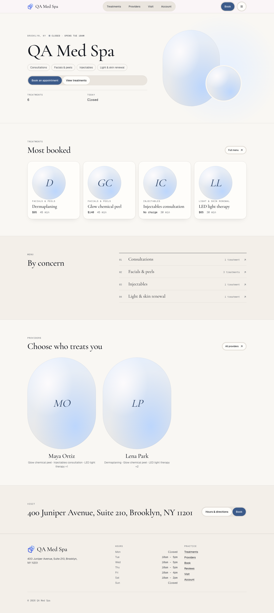
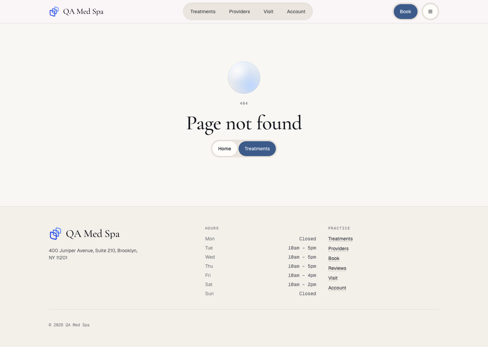
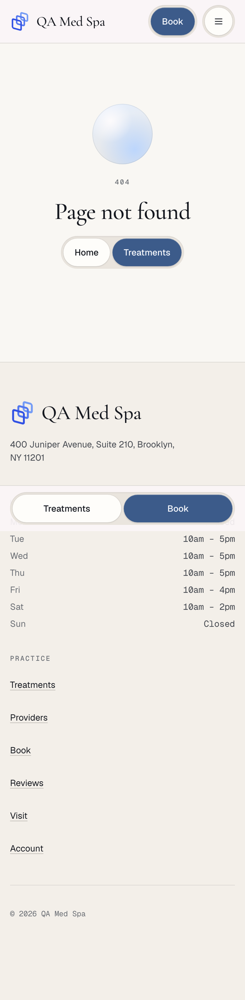

# Night linen: medspa storefront redesign, 2026-10-25

Live: https://openfront-medspa-production.up.railway.app  
Commits (master, auto-deployed on Railway): b91ea7e, b6dbaff, e9554bc, ba57cbe, 3edf3f9  
Brief: `~/Code/Euler/state/briefs/design-skills-redesign-2026-10-25.md` (Openfront Batch 3, storefront only)

## The world
The storefront is a stack of charcoal-dyed spa linen: the page is the darkest fold, every band and card a fold a tone lighter with a crease that catches the light, colour pages are linen dyed in the practice's logo hue, and the treatment menu reads as a printed menu on one axis. EB Garamond (vendored with its OFL licence, like the repo's other storefront fonts) sets everything.

Owner bar applied: dark, considered and premium; no grey washed-out ground; no generic SaaS cards; no gradient or glow; UI copy is labels, states and errors only; phone width works. Tessier (dark editorial poster, objects floating on near-black, one display voice used sparingly) was the reference.

## What changed (presentation only; every route, state and workflow kept)
- Home: the hero on a 42/58 axis, with side notes (locality, open state, treatments, today) and the provider portrait on the left and the practice name very large with categories and Book an appointment on the right; Treatments as printed menu lines; By concern and Visit as dyed colour pages.
- The treatment ledger everywhere reads as a printed menu: a crease between lines, duration and price in one right column at the same size.
- Truth fix from review: the home section fed by an alphabetical list was titled "Most booked" and is now "Treatments".
- No placeholder monogram tiles where images are missing; labels above page titles removed, or reduced to the data they carry; the booking stepper fits 390px; pressing a fold darkens it.

Routes captured: /, /services, /services/[id], /team, /team/[id], /book, /contact, /gallery, /reviews, /gift-cards, /account/sign-in (booking confirmation, appointments, intake and account share the same layer).

## Skills used, and how
- **Impeccable** (pbakaus): `impeccable context` loaded project state; `init` wrote `PRODUCT.md` (facts inferred from the repo and the brief, marked as inferred, because the brief ordered no approval stage); `concept-seed --scope direction --mode persuade` rolled the direction against my own ranked list of seven grounded candidates (the roll picked which one to build; challengers were weighed and their disciplines raised into the contract); the direction contract lives in `.impeccable/surfaces/features-storefront.md`; `reference/craft-floor.md` set the build floor; the shipped **impeccable-finish-reviewer** ran a full review, then a verdict pass on the fixes; the **impeccable-documenter** wrote `DESIGN.md` and `.impeccable/design.json` from the shipped code. No image generation was available, so the build was code-led (no comps) and the decision page was skipped (the brief said not to stop for approval).
- **design-taste-frontend** (Leon, tasteskill v2): `draw.mjs` dealt three directions and the full sheet of the chosen one (composition, type system, section blueprints), with slots redrawn only for stated reasons (listed below); the house rules (no eyebrows above headings, no monospace, no tracked tiny capitals, no gradients or glass, no index numbers, two faces at most, 13px type floor) and `lint.mjs` as a gate (0 FAIL on the storefront; deliberate world rules are marked `taste-skill-ignore` with the reason).
- **emil-design-eng**: custom ease-out `cubic-bezier(0.23, 1, 0.32, 1)`, press feedback on every control, hover gated to `(hover: hover) and (pointer: fine)`, entrances from an already-visible default, motion under `prefers-reduced-motion`.
- **frontend-design**: the anti-default calibration (no cream plus serif, no neon on black, no SaaS card kit) and the rule of one bold move per page.
- **high-end-visual-design** and **minimalist-ui** were read; both are opt-in light styles that conflict with the owner's pinned dark direction, so only their restraint on copy and components was used.
- Not used: gpt-taste, creative-director, brand-extract, brandkit, color-expert, animate, prototype, break-ui, mobile-native, pick-ui-library, hallmark, apple-design, taste-design.

Taste-skill direction for this repo: editorial-report (one off-centre axis at 42%, side notes in the margin, printed-menu lines); the dealt EB Garamond adopted; the dealt light palette translated to the pinned dark.

## Gates (final state)
- Typecheck: `tsc --noEmit -p .` through `heavy-exec.py`, child exit 0, 0 errors, after every batch.
- Parity: `python3 -I platform-parity-audit-2026-10-20/parity-check.py` exit 0, drift 0, missing 0, sidebar-branding ok, sidebar-structure ok, after every batch. Only storefront files changed; the shared dashboard shell and platform pages are untouched.
- Live CSS checked for selectors that exist only in the new stylesheet after each deploy (guards against the Railway stale-compile issue).
- Every route below returned 200 (or the intended 404) on the live site with no horizontal overflow at 1440 and 390.

## Finish review
- Round 1 (fresh impeccable-finish-reviewer): disposition **fix**, with a material-fix list. Every item was applied in one batch, typechecked, parity-checked, pushed and recaptured.
- Round 2 (verdict pass on the recaptures): the remaining partials and small regressions it named were fixed in a final batch. The Impeccable documenter then wrote `DESIGN.md` and `.impeccable/design.json` from the shipped code, and the drift it flagged was cleaned up in the last commit. Two rounds is Impeccable's budget for an unattended run, so no third review ran. The final state hasn't been reviewer-certified as **ship**.

## Open items
- The fixed phone booking bar overlaps a strip of content in full-page phone screenshots. This is a capture artefact of fixed elements, not a layout defect.

## Before and after
Before: the live site at the start of this work. These shots are on the demo data that existed then; a separate session reset and re-seeded every demo store the same afternoon, so the store name and catalog differ from the after shots.

After (live, 1440 desktop and 390 phone, full page):

- [after-account_sign_in-desktop.png](design/redesign-20261025/after-account_sign_in-desktop.png)
- [after-account_sign_in-phone.png](design/redesign-20261025/after-account_sign_in-phone.png)
- [after-book-desktop.png](design/redesign-20261025/after-book-desktop.png)
- [after-book-phone.png](design/redesign-20261025/after-book-phone.png)
- [after-contact-desktop.png](design/redesign-20261025/after-contact-desktop.png)
- [after-contact-phone.png](design/redesign-20261025/after-contact-phone.png)
- [after-gallery-desktop.png](design/redesign-20261025/after-gallery-desktop.png)
- [after-gallery-phone.png](design/redesign-20261025/after-gallery-phone.png)
- [after-gift_cards-desktop.png](design/redesign-20261025/after-gift_cards-desktop.png)
- [after-gift_cards-phone.png](design/redesign-20261025/after-gift_cards-phone.png)
- [after-home-desktop.png](design/redesign-20261025/after-home-desktop.png)
- [after-home-phone.png](design/redesign-20261025/after-home-phone.png)
- [after-reviews-desktop.png](design/redesign-20261025/after-reviews-desktop.png)
- [after-reviews-phone.png](design/redesign-20261025/after-reviews-phone.png)
- [after-services-desktop.png](design/redesign-20261025/after-services-desktop.png)
- [after-services-phone.png](design/redesign-20261025/after-services-phone.png)
- [after-services_cmvocd1ss000fmf012j1bz7fg-desktop.png](design/redesign-20261025/after-services_cmvocd1ss000fmf012j1bz7fg-desktop.png)
- [after-services_cmvocd1ss000fmf012j1bz7fg-phone.png](design/redesign-20261025/after-services_cmvocd1ss000fmf012j1bz7fg-phone.png)
- [after-team-desktop.png](design/redesign-20261025/after-team-desktop.png)
- [after-team-phone.png](design/redesign-20261025/after-team-phone.png)
- [after-team_cmvocd2g5000rmf01ib7yjl5d-desktop.png](design/redesign-20261025/after-team_cmvocd2g5000rmf01ib7yjl5d-desktop.png)
- [after-team_cmvocd2g5000rmf01ib7yjl5d-phone.png](design/redesign-20261025/after-team_cmvocd2g5000rmf01ib7yjl5d-phone.png)

Product facts are in `PRODUCT.md`, the direction contract is in `.impeccable/surfaces/features-storefront.md`, and the recorded system is in `DESIGN.md`.
